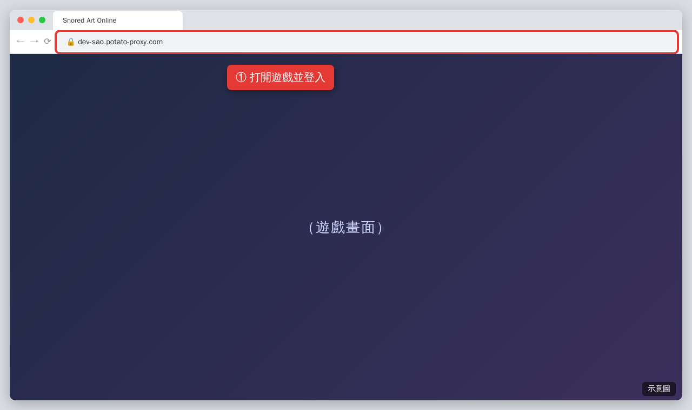
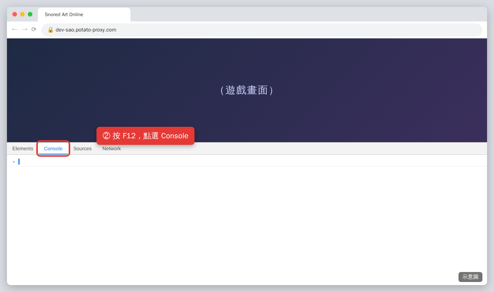
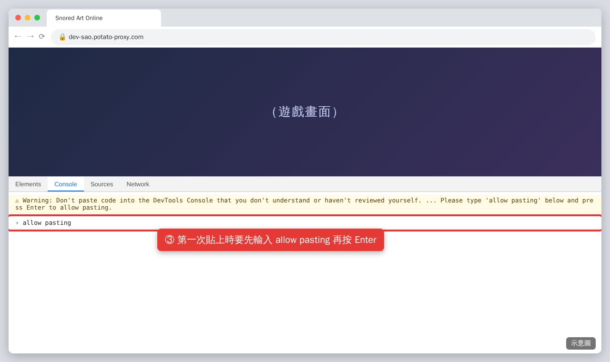
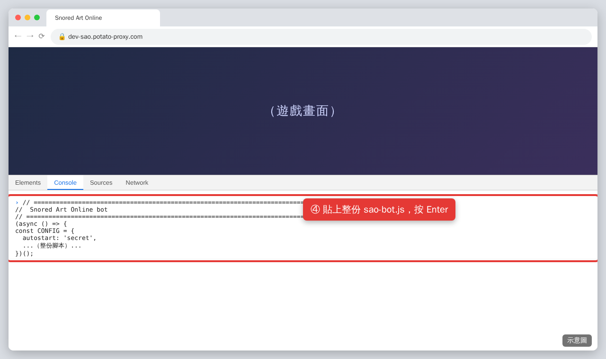
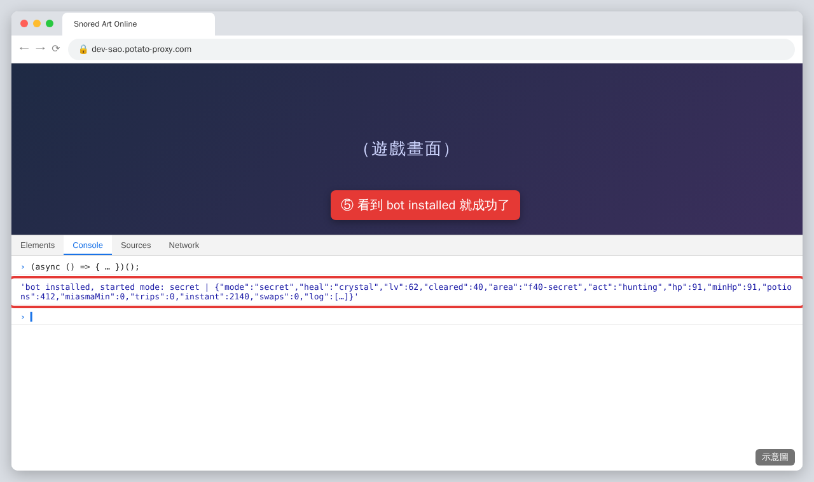
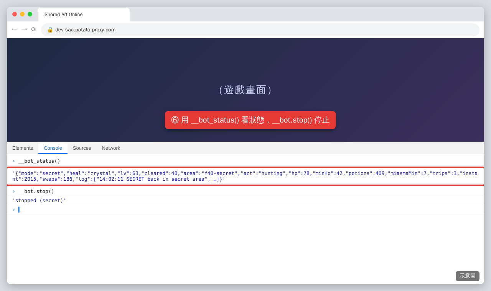

# SAO 掛機腳本（Snored Art Online）

在瀏覽器 Console 執行的 **Snored Art Online**（`dev-sao.potato-proxy.com`）掛機腳本。
它透過遊戲網頁本身的連線，送出跟按鈕一樣的指令，所以**不用安裝任何東西**。

**預設：貼上後會自動開始「秘境練功」（`secret` 模式）。**

| 模式 | 功能 |
|------|------|
| `secret`（預設） | 在 40 層秘境刷經驗。定時回城重置瘴氣、自動補瞬間藥水、自動排技能。 |
| `farm` | 重複打指定的 Boss，直到每種掉落物都收集夠數量。Boss 冷卻時會自動打怪。 |
| `level` | 自動接任務、交任務、跑主線劇情、到最好的安全地圖練等，等級夠了就打下一層 Boss。到目標等級自動停止。 |

另外有一個**保命系統**，不管在哪個模式（包括停止時）都會一直運作：血量低時自動喝水、用緊急治療或傳送水晶。

---

## 使用教學（一步一步）

> 下面的圖片是示意圖，實際畫面會跟你的遊戲和瀏覽器有些不同。

### 步驟 1：打開遊戲並登入

用電腦版 Chrome（或 Edge）打開 `dev-sao.potato-proxy.com`，登入你的角色。
**建議先手動走到 40 層**（秘境模式在 40 層運作）。



### 步驟 2：打開開發者工具的 Console

- Windows：按 `F12` 或 `Ctrl + Shift + J`
- Mac：按 `Cmd + Option + J`

在跳出來的面板上方，點選 **Console** 分頁。



### 步驟 3：允許貼上（只有第一次需要）

第一次在 Console 貼東西時，Chrome 會出現黃色警告，並且不讓你貼上。
在下方輸入 `allow pasting`，按 **Enter**。



### 步驟 4：貼上腳本

1. 打開本專案的 [`sao-bot.js`](sao-bot.js)，點右上角的 **Copy raw file**（複製）按鈕，複製**整份**內容。
2. 回到 Console，貼上（`Ctrl + V` / `Cmd + V`），按 **Enter**。



### 步驟 5：確認安裝成功

等幾秒鐘，看到 `bot installed, started mode: secret` 就代表成功，腳本已經開始秘境練功了。



### 步驟 6：查看狀態／停止

在 Console 輸入以下指令並按 Enter：

- `__bot_status()`：查看目前狀態（模式、等級、地點、血量、藥水數量、最近紀錄）
- `__bot.stop()`：停止掛機



### 注意事項

- **遊戲分頁要保持開著。** 瀏覽器會讓背景分頁變慢，建議把遊戲放在獨立視窗，並保持可見。
- **重新整理網頁後，腳本就會消失。** 要再從步驟 4 貼一次。
- 貼上後可以關掉開發者工具，腳本會繼續運作。

---

## 常用指令

| 指令 | 功能 |
|------|------|
| `__bot.start('secret')` | 開始秘境練功 |
| `__bot.start('farm')` | 開始刷 Boss 掉落物 |
| `__bot.start('level')` | 開始自動練等（任務、劇情、打怪、打樓層 Boss） |
| `__bot.stop()` | 停止目前模式。角色會維持原本的動作，保命系統仍然開著。 |
| `__bot_status()` | 顯示一行狀態 |
| `__bot.log` | 腳本最近 300 筆動作紀錄 |
| `__bot.farmStatus()` | 每個刷寶目標的進度 |
| `__bot.cfg` | 目前的設定（見下方） |

同一時間只會跑一個模式，開始新模式會取代舊的。

---

## 設定

所有設定都在 `sao-bot.js` 最上面的 `CONFIG` 區塊。有兩種改法：

- **貼上前先改檔案**：每次貼上都會用你的設定。
- **執行中在 Console 直接改**，例如：`__bot.cfg.level.targetLevel = 90`。重新整理網頁後會恢復預設。

血量都用小數表示：`0.25` 代表 25%。

### 開機設定

| 設定 | 預設值 | 說明 |
|------|--------|------|
| `autostart` | `'secret'` | 貼上後自動開始的模式：`'secret'`、`'farm'`、`'level'`，或 `'none'`（只安裝、不開始） |
| `blockReload` | `true` | 阻止伺服器更新時網頁自動重新整理（重新整理會讓腳本消失），建議保持開啟 |

### 回血（`heal`）

| 設定 | 預設值 | 說明 |
|------|--------|------|
| `mode` | `'auto'` | `'bot'`：由腳本依照下面的百分比喝水、緊急治療、傳送。<br>`'crystal'`：由遊戲內建的自動喝水負責回血（到遊戲的**設定**選好藥水和百分比），腳本只在快死時用全回復水晶。<br>`'auto'`：秘境模式用 `'crystal'`，其他模式用 `'bot'`。<br>`'off'`：腳本完全不幫你回血。 |
| `teleportAt` | `0.20` | 血量低於 20% 時用傳送水晶 |
| `emergencyAt` | `0.40` | 血量低於 40% 時用緊急治療 |
| `potionAt` | `0.50` | 血量低於 50% 時喝藥水 |
| `boss` | `{0.20, 0.40, 0.70}` | 同上三個數值，打 Boss 時使用 |
| `crystalAt` | `0.20` | `'crystal'` 模式下，血量低於 20% 時用全回復水晶（沒有的話用傳送水晶） |
| `afterTeleportWaitMs` / `resumeAt` | `60000` / `0.95` | 傳送回城後，最多等 60 秒讓血量回到 95% 再出發 |
| `maxHpFallback` | `18000` | 最大血量會從畫面讀取，讀不到時才用這個數字 |

> **秘境模式預設用 `'crystal'`**，所以請先在遊戲的**設定**裡開啟自動喝水（選藥水和百分比），並準備一些全回復水晶（`crystal-heal`）。

### 道具（`items`）

腳本會購買和使用的道具 ID：`potion`（`potion-2d`）、`teleport`（`crystal-teleport`）、`fullHeal`（`crystal-heal`）、`instant`（`instant-2`）。想換別的藥水就改這裡。

### 秘境模式（`secret`）

秘境會有**瘴氣**減益：每待 20 分鐘，受到的傷害 +15%。只有站在該層的城鎮時，瘴氣計時才會歸零，所以腳本會每隔幾分鐘走回城鎮，再馬上回來。

| 設定 | 預設值 | 說明 |
|------|--------|------|
| `floor` / `area` / `town` | `40` / `'f40-secret'` / `'f40-town'` | 秘境所在的樓層、地圖和城鎮 |
| `pathToTown` | `f40-field` → `f40-outskirts` → `f40-town` | 從秘境走回城鎮時，依序經過的地圖 |
| `pathToSecret` | `f40-field` → `f40-secret` | 從城鎮走回秘境時，依序經過的地圖 |
| `nextToSecret` | `['f40-depths']` | 可以直接走進秘境的地圖 |
| `resetEveryMin` | `15` | 在秘境待幾分鐘後回城重置瘴氣 |
| `restAt` | `0.70` | 在城鎮時，血量回到 70% 以上才出發 |
| `targetLevel` | `70` | 到這個等級就停止 |
| `instantMin` / `instantRestockTo` | `500` / `3000` | 瞬間藥水少於 500 瓶時，買到 3000 瓶 |
| `shopFloor` | `16` | 哪一層的城鎮有賣瞬間藥水 |

### 刷寶模式（`farm`）

| 設定 | 預設值 | 說明 |
|------|--------|------|
| `minHp` | `0.80` | 血量 80% 以上才開始打 Boss |
| `priorityFloor` | `32` | 同時有多隻 Boss 可以打時，先打這一層 |
| `targets` | 5 隻 Boss | 要刷的 Boss 清單，見下方 |

每個目標的格式：

```js
{ f: 32, id: 'boss-f32', name: '晶心戒指', need: 10 }
```

- `f`：Boss 所在樓層
- `id`：想要的掉落物道具 ID。背包裡的和**身上裝備的**都會算進去。
- `need`：擁有幾個就不再刷這隻 Boss
- `name`：只是顯示用的名字（`__bot.farmStatus()` 會顯示）

全部目標完成後會自動停止。必須先打通該樓層，才能刷那層的 Boss。

### 練等模式（`level`）

| 設定 | 預設值 | 說明 |
|------|--------|------|
| `targetLevel` | `80` | 到這個等級就停止 |
| `maxFloor` | `40` | 最高只到這一層 |
| `bossMargin` | `2` | 樓層 Boss 至少比你低這麼多級才去打。想打得更穩就調高。 |
| `bossStartHp` | `0.97` | 血量 97% 以上才開始打樓層 Boss |
| `potionMin` / `potionBuy` | `100` / `300` | 藥水少於 100 瓶時，去買 300 瓶 |

### 技能自動排序（`cycler`）

一般戰鬥中，自動把「**冷卻好了**」的最強技能排到第 1 格。打 Boss 時不會動。

| 設定 | 預設值 | 說明 |
|------|--------|------|
| `useIn` | `['secret']` | 哪些模式要用。例如 `['secret', 'level']`；設成 `[]` 就是關閉。 |
| `score` | 7 個技能 | 技能 ID → 分數。分數越高越優先。 |

**請把 `score` 改成你自己的技能。** 只有列在裡面的技能會被移動，沒學的技能會被忽略；其他技能會放在剩下的格子。

---

## 範例

秘境每 10 分鐘回城一次，練到 75 級：

```js
__bot.cfg.secret.resetEveryMin = 10
__bot.cfg.secret.targetLevel = 75
```

改成只刷 35 層 Boss，拿到 5 個就停：

```js
__bot.cfg.farm.targets = [{ f: 35, id: 'boss-f35', name: '35 層頭盔', need: 5 }]
__bot.cfg.farm.priorityFloor = 35
__bot.start('farm')
```

練到 75 級，打樓層 Boss 打得更保守：

```js
__bot.cfg.level.targetLevel = 75
__bot.cfg.level.bossMargin = 4
__bot.start('level')
```

貼上後不要自動開始：把檔案裡的 `autostart` 改成 `'none'`。

---

## 常見問題

**出現「the game socket was not seen yet」**
在遊戲裡隨便點一下（分頁或按鈕），讓網頁送出資料，然後在 Console 輸入 `__bot.ws.close()`。遊戲會重新連線，腳本就能抓到資料。

**出現「no state arrived yet」**
等幾秒後輸入 `__bot_status()`。如果還是顯示 `BOT MISSING`，重新整理網頁後再貼一次腳本。

**腳本好像沒在動**
- 輸入 `__bot_status()`，如果 `mode` 是 `"none"`，代表已經停止了（到達目標等級、刷寶完成、或角色死亡）。用 `__bot.log` 看原因。
- 練等模式可能正在傳送後休息，或正在走去城鎮買藥水。

**一直走回城鎮**
- 秘境模式會定時回城重置瘴氣，這是正常的。
- 藥水用完又找不到商店時，會等 10 分鐘後再試。

**要換新版腳本**
直接再貼一次新版即可，會自動停掉舊版。最乾淨的做法是先重新整理網頁再貼。

---

## 免責聲明

使用掛機腳本可能違反遊戲規則，請自行承擔風險。
